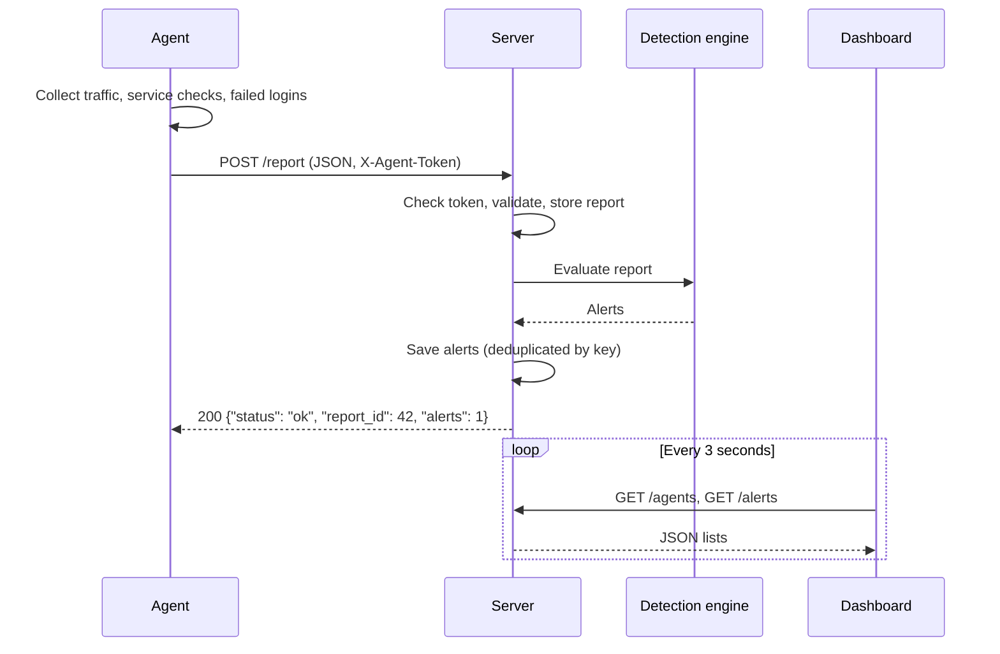

# Agent/Server Protocol

How monitoring agents report to the central server, how the server turns reports into alerts, and the security measures around both. Endpoint parameters and response schemas are generated by FastAPI at `http://127.0.0.1:8000/docs`; this document covers the rules that page does not.

## 1. Overview

Each agent collects traffic counters, service checks and failed logins, then sends one JSON report to the server every 10 seconds over HTTP. The server validates the report, stores it in SQLite, runs the detection rules and saves any alerts. The dashboard polls the server for agents and alerts.



HTTP fits because data only flows one way: agents push reports and never need the server to push to them. Each request stands alone, so an agent recovers from a server restart with its next report, with no reconnect logic. Plain HTTP is also easy to capture and read in Wireshark.

## 2. Sending a report

| Item | Value |
| --- | --- |
| Request | `POST /report` |
| Headers | `Content-Type: application/json`, `X-Agent-Token: <AGENT_TOKEN>` |
| Body size | At most 1,000,000 bytes |
| Interval | Every `REPORT_INTERVAL_S` seconds (default 10) |

Example body:

```json
{
  "agent_id": "agent-web-01",
  "timestamp": "2026-11-10T01:14:56.897391+00:00",
  "traffic": {"bytes_in": 52344, "bytes_out": 18820, "packets_in": 410, "packets_out": 300, "interval_s": 10.02},
  "failed_logins": [{"user": "admin", "source_ip": "10.0.0.66", "time": "2026-11-10T01:14:51+00:00"}],
  "services": [
    {"name": "target", "host": "127.0.0.1", "port": 9000, "up": true, "response_ms": 4.2, "error": null},
    {"name": "control", "host": "127.0.0.1", "port": 9001, "up": false, "response_ms": null, "error": "refused"}
  ]
}
```

## 3. Field rules

Any field not listed here is rejected, at every level. Numbers, booleans and strings are strict: `"80"` is not a port and `"true"` is not a boolean.

| Field | Rule |
| --- | --- |
| `agent_id` | 1–64 characters: letters, digits, `.`, `_`, `-` |
| `timestamp` | ISO 8601 with a timezone (`Z` or `+00:00`). Stored, but the server uses its own receive time to track agents |
| `traffic.bytes_in`, `bytes_out`, `packets_in`, `packets_out` | Integer, 0 or more |
| `traffic.interval_s` | Number greater than 0, finite |
| `failed_logins` | At most 1,000 entries |
| `failed_logins[].user` | 1–128 characters |
| `failed_logins[].source_ip` | IPv4 or IPv6 address |
| `failed_logins[].time` | ISO 8601 with a timezone |
| `services` | At most 50 entries, each with a unique `name` |
| `services[].name` | 1–128 characters |
| `services[].host` | 1–255 characters |
| `services[].port` | Integer, 1–65535 |
| `services[].up` | `true` or `false` |
| `services[].response_ms` | Number 0 or more and finite, or `null`. The key is required |
| `services[].error` | `null`, `timeout`, `refused`, `dns`, `unreachable`, or `http_5xx` with the real code (for example `http_503`) |

Each service result must also be consistent: when `up` is `true`, `error` is `null` and `response_ms` is a number; when `up` is `false`, `error` is set.

## 4. Service checks

Each service gets one check, chosen by its URL in the agent's `SERVICES` setting: `http://` or `https://` gets an HTTP check, and `tcp://` gets a TCP connection check.

The HTTP check sends a `GET` without following redirects, waits at most 2 s to connect and 3 s for the response to start, and times the request until the status and headers arrive. The body is never downloaded, so the time measures the server, not the page size.

| Outcome | `up` | `response_ms` | `error` |
| --- | --- | --- | --- |
| 2xx, 3xx, 4xx response | `true` | measured | `null` |
| 5xx response | `false` | measured | `http_5xx` |
| No response within the timeouts | `false` | `null` | `timeout` |
| Connection refused | `false` | `null` | `refused` |
| Host name not found | `false` | `null` | `dns` |
| Any other network failure | `false` | `null` | `unreachable` |

A 4xx counts as up because the service answered; the request itself was wrong. The TCP check uses the same 2 s connect timeout and reports the connect time as `response_ms`.

These timeouts give three zones: under 1 s is healthy, 1–3 s is up but slow (a latency alert), and over 3 s is down. `response_ms` is `null` exactly when no response came back.

## 5. Failed logins

The agent reads the target service's log (`AUTH_LOG_PATH`, default `env/logs/auth.log`), which holds one JSON object per failed attempt. Each report carries only the attempts logged since the previous report:

- Reading starts at the end of the log when the agent starts, so old attempts are never resent.
- Only complete lines are read; a line still being written waits for the next report.
- If the log is cleared or replaced, the agent reads the new one from the start.
- Times are sent with their timezone, so the server can store them as UTC.

The username and source IP come from the login request, so an attacker controls them. One invalid entry would get the whole report rejected, so the agent fixes or drops entries first: usernames are cut to 128 characters, an empty username is sent as `(empty)`, and entries with an invalid IP or a timestamp without a timezone are skipped and counted. When more than 1,000 attempts arrive in one interval, the latest 1,000 are sent.

## 6. Responses and agent behavior

| Status | Meaning | Body |
| --- | --- | --- |
| 200 | Report stored | `{"status": "ok", "report_id": 42, "alerts": 1}` |
| 400 | `Content-Length` header is not a number | `{"detail": "invalid Content-Length"}` |
| 401 | Token missing or wrong; checked before the body | `{"detail": "missing or invalid X-Agent-Token"}` |
| 413 | Body over 1,000,000 bytes | `{"detail": "request body too large"}` |
| 422 | Body breaks a rule in section 3 | FastAPI's list of errors, each with the field's location and the reason |
| 5xx | Server error | Varies |

`alerts` counts the alerts this report raised or repeated. A report stays stored even if detection fails; the error is logged on the server and the response still says 200.

The agent sends each report once, with the same 2 s and 3 s timeouts, and never resends it. If a report is lost, the next one replaces it with newer data. Whatever the outcome, the agent prints it and keeps running, so fixing a wrong token on the server needs no agent restart.

The agent waits one interval minus the time its checks and send took, which keeps reports evenly spaced. With three services, the longest possible gap is 20 s (three 5 s checks plus a 5 s send), well under the 30 s offline threshold.

## 7. Detection and alerts

The detection engine runs on the server after each report is stored. It keeps a short history in memory and is shared by all requests behind a lock.

| Alert type | Raised when | Severity |
| --- | --- | --- |
| `BRUTE_FORCE_LOGIN` | More than 5 failed logins from one IP within 60 s | HIGH |
| `TRAFFIC_SPIKE` | `(bytes_in + bytes_out) / interval_s` over 1,000,000 bytes per second | MEDIUM |
| `HIGH_LATENCY` | `response_ms` over 1,000 | LOW |
| `SERVICE_DOWN` | A service down for 2 checks in a row | HIGH |
| `AGENT_OFFLINE` | No report from an agent for over 30 s | HIGH |

Every alert has a key of the form `TYPE:agent_id:subject`, for example `BRUTE_FORCE_LOGIN:agent-web-01:10.0.0.66` or `SERVICE_DOWN:agent-web-01:target`. Traffic and offline alerts have no subject: `TRAFFIC_SPIKE:agent-web-01`, `AGENT_OFFLINE:agent-web-01`.

The engine raises an alert on every report while its condition holds. The server keeps one active alert per key: a repeat updates that alert's count, latest message and last-seen time instead of adding a row. A unique index in the database enforces this even when reports arrive at the same moment. An alert resolves after 60 s without a repeat (`ALERT_EXPIRY_S`).

Offline detection runs in a background task every 5 s (`SWEEP_INTERVAL_S`). An agent silent for over 30 s (`OFFLINE_THRESHOLD_S`) is marked offline and raises `AGENT_OFFLINE`. Offline alerts never expire, because nothing repeats them while the agent is silent; they resolve as soon as the agent reports again. Silence is measured from the later of the agent's last report and the server's start, so a restarted server gives every agent 30 s to report before flagging it. Agents listed in `EXPECTED_AGENTS` are tracked from startup, so one that never starts is flagged too.

All times are stored in UTC, in one fixed format so that text order matches time order. The server tracks agents with its own clock, not the agent's `timestamp`, so a machine with a wrong clock is not mistaken for an offline agent.

## 8. Security measures

- **Agent authentication:** every report needs the shared `AGENT_TOKEN`. Tokens are compared in constant time, so response timing reveals nothing about the token. The token is checked before the body, so a caller without it learns nothing about the report format.
- **Development token:** with no `AGENT_TOKEN` set, the server and agent share a built-in development token so local testing needs no setup. The server logs a warning at startup whenever it is in use. A custom token must be at least 16 characters.
- **Strict validation:** unknown fields, wrong types, out-of-range values, non-finite numbers and oversized lists are rejected. A rejected report stores nothing.
- **Size limit:** bodies over 1 MB are refused before they are read into memory.
- **Attacker-controlled text:** usernames and service names can contain anything an attacker types. The agent bounds them before sending, and the dashboard displays all data as plain text, so text like `<script>` is shown, never run.
- **Read-only public endpoints:** `GET /agents`, `/alerts` and `/metrics` need no token and change nothing. `/metrics` returns the number of failed logins per report, not the usernames.
